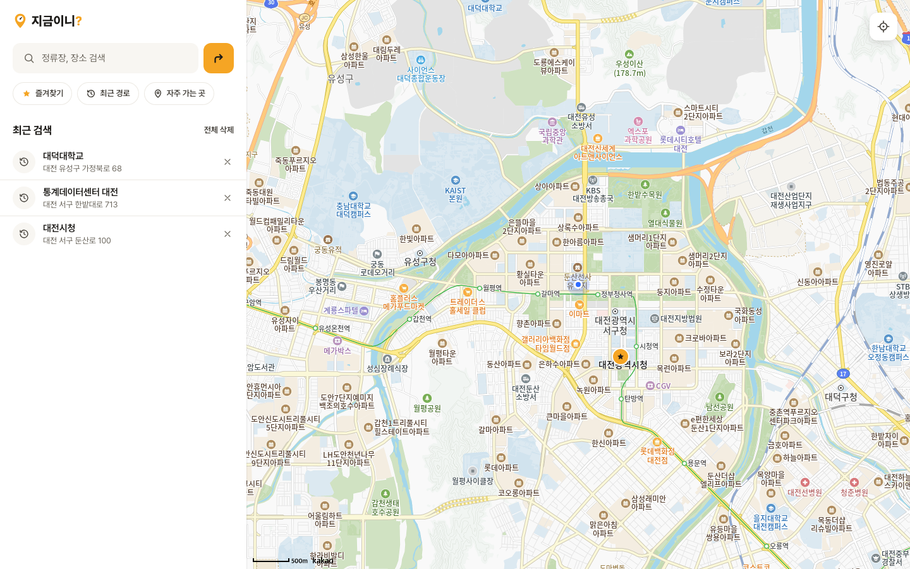
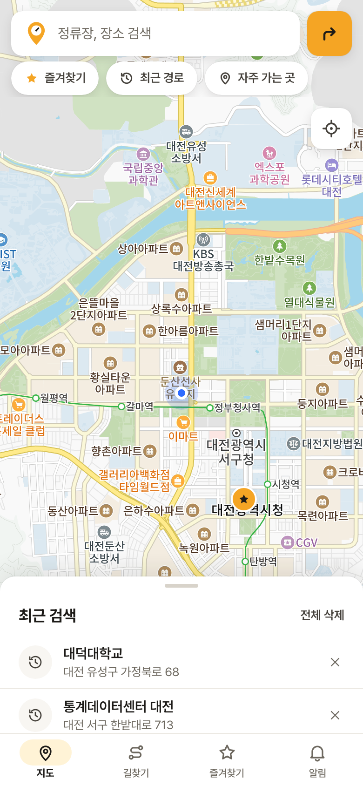
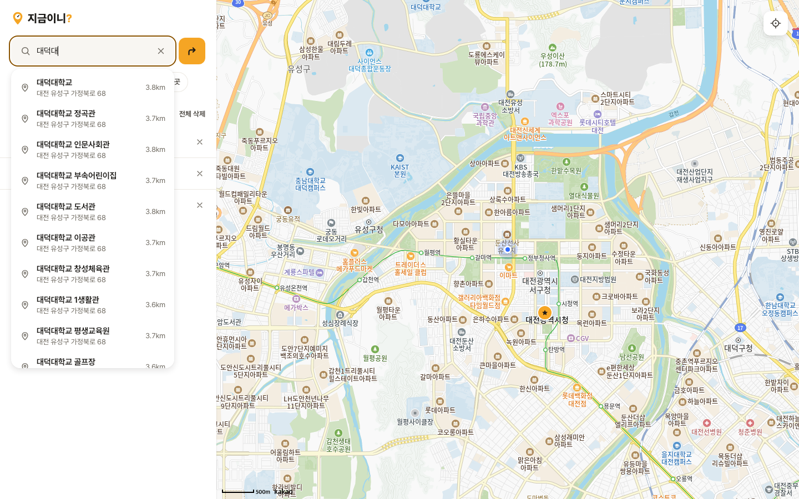
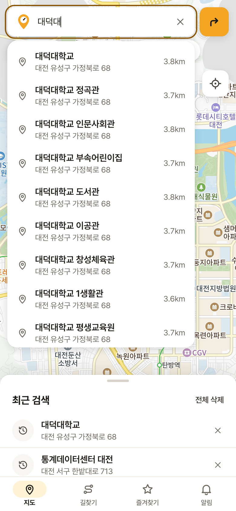
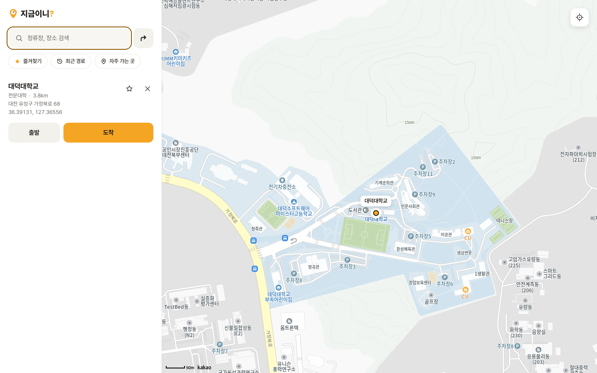
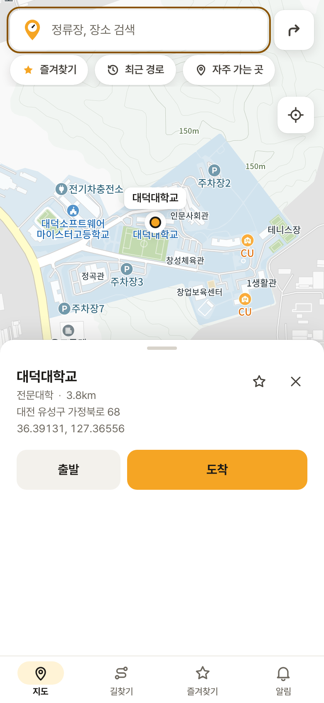
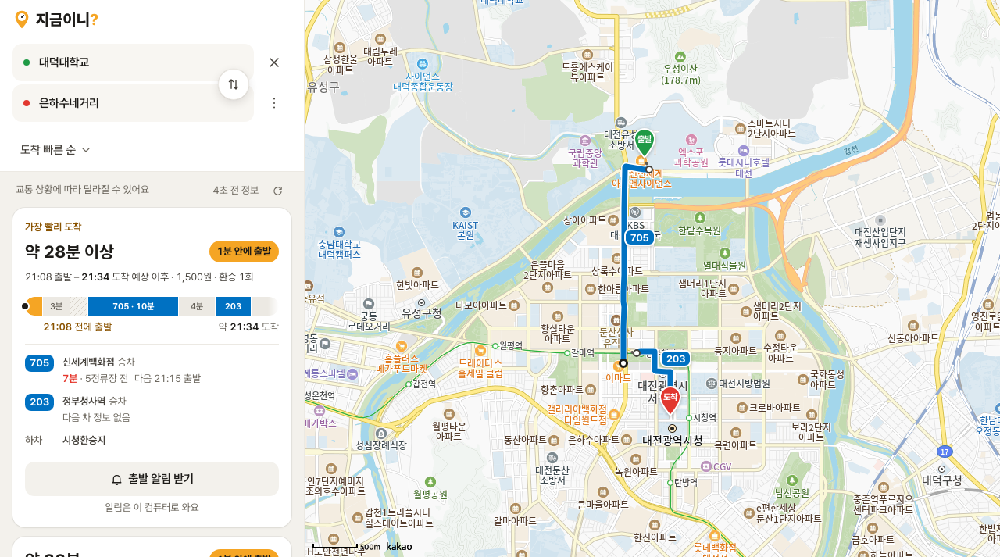
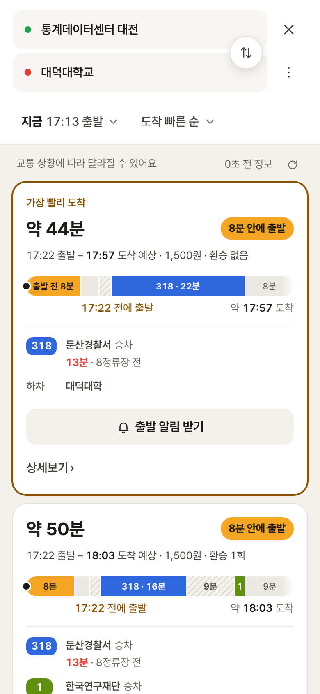
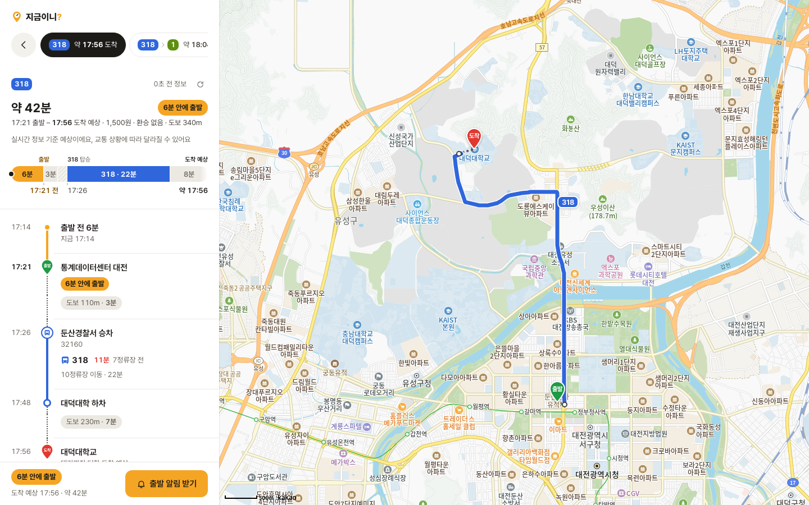
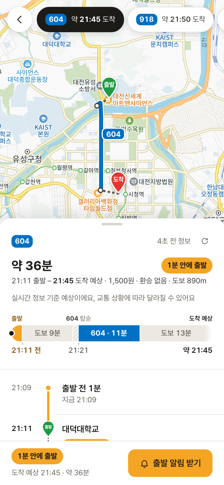

  

<h1 align="center">지금이니?</h1>

  기다림까지 더한 도착 예상 시간과, <b>언제까지 나서면 되는지</b> 알려주는 대전·서울 버스 길찾기

  <a href="https://jigeumini.vercel.app">https://jigeumini.vercel.app</a>

 

## 목차

- [서비스 기능](#서비스-기능)
  - [1. 지도 홈과 즐겨찾기](#1-지도-홈과-즐겨찾기)
  - [2. 장소 검색과 최근 검색](#2-장소-검색과-최근-검색)
  - [3. 장소 카드에서 바로 길찾기](#3-장소-카드에서-바로-길찾기)
  - [4. 경로 목록: 언제 나가면 되는지](#4-경로-목록-언제-나가면-되는지)
  - [5. 경로 상세: 출발부터 도착까지 시간 순서로](#5-경로-상세-출발부터-도착까지-시간-순서로)
  - [6. 앱처럼 설치하기 (PWA)](#6-앱처럼-설치하기-pwa)

 

## 서비스 기능

### 1. 지도 홈과 즐겨찾기

| 데스크톱 | 모바일 |
| :---: | :---: |
|  |  |

- 앱을 열면 **현재 위치를 중심으로** 지도가 보여요. 대전과 서울에서 쓸 수 있고, 두 도시 밖이면 대전이나 서울 지도로 옮길 수 있어요. 오른쪽 위 버튼으로 언제든 현재 위치로 돌아올 수 있어요.
- 즐겨찾기한 장소는 지도 위에 **주황색 별 마커**로 항상 표시돼요. 마커를 누르면 그 장소 카드가 열려요.
- 로그인 화면 없이 처음 방문할 때 익명 계정이 만들어지고, 즐겨찾기는 그 계정에 저장돼서 새로고침하거나 앱을 다시 열어도 남아 있어요.

 

### 2. 장소 검색과 최근 검색

| 데스크톱 | 모바일 |
| :---: | :---: |
|  |  |

- 검색창에 장소 이름을 입력하면 **현재 위치 주변**의 장소가 거리와 함께 바로 나와요.
- 검색해서 고른 장소는 **최근 검색**에 쌓여요. 이 기기에 저장돼서 다음에 열어도 그대로 있어요.
- 최근 검색은 항목마다 오른쪽 **X**로 하나씩 지우거나, **전체 삭제**로 한 번에 비울 수 있어요.

 

### 3. 장소 카드에서 바로 길찾기

| 데스크톱 | 모바일 |
| :---: | :---: |
|  |  |

- 장소를 고르면 지도가 그 장소로 이동하고, 주소와 현재 위치에서의 거리가 담긴 카드가 열려요.
- 카드의 **출발 / 도착** 버튼을 누르면 그 장소를 출발지나 목적지로 넣고 바로 길찾기로 넘어가요.
- 별 버튼으로 즐겨찾기에 추가하거나 뺄 수 있어요.

 

### 4. 경로 목록: 언제 나가면 되는지

| 데스크톱 | 모바일 |
| :---: | :---: |
|  |  |

- 대중교통 경로에 **대전·서울 버스 실시간 도착 정보**를 합쳐서, 지금 탈 수 있는 버스 기준으로 도착 시각을 계산해요.
- 경로마다 **"8분 안에 출발", "17:22 전에 출발"** 처럼 집에서 언제 나가면 되는지 먼저 보여줘요.
- 막대 그래프 한 줄로 **출발 전 남은 시간 · 걷기 · 정류장 대기 · 버스 탑승**을 시간 비율대로 보여줘요.
- 출발 시각에는 **버스가 예측보다 일찍 오는 경우를 대비한 여유 시간**이 들어 있어요. 정류장별로 실제로 쌓은 도착 예측 오차 데이터(10번 중 9번은 놓치지 않는 기준)로 계산하고, 데이터가 부족한 정류장은 2분을 둬요.
- 탈 정류장에 버스가 **몇 분 뒤, 몇 정류장 전**에 있는지도 함께 보여줘요.
- 도착 빠른 순 / 도보 짧은 순 / 환승 적은 순으로 정렬할 수 있어요.

 

### 5. 경로 상세: 출발부터 도착까지 시간 순서로

| 데스크톱 | 모바일 |
| :---: | :---: |
|  |  |

- 출발 전 대기 → 걷기 → 승차 정류장 → 하차 → 도착까지 **시각과 함께 한 줄 타임라인**으로 보여줘요.
- 지도에는 걷는 구간과 버스 구간이 노선 색으로 그려져요.
- 위쪽 탭으로 다른 경로로 바로 바꿔 볼 수 있어요.

 

### 6. 앱처럼 설치하기 (PWA)

| 아이폰 시작 화면 |
| :---: |
|  |

- 브라우저에서 **홈 화면에 추가**하면 주소창 없이 앱처럼 열려요. (아이폰: Safari 공유 → 홈 화면에 추가, 안드로이드: Chrome 메뉴 → 앱 설치)
- 실행할 때는 흰 화면에 서비스 아이콘과 이름이 뜨는 시작 화면이 보여요.
