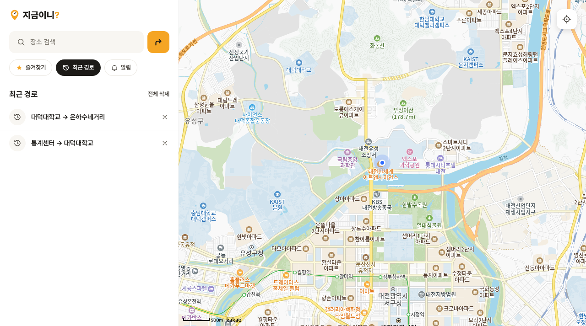
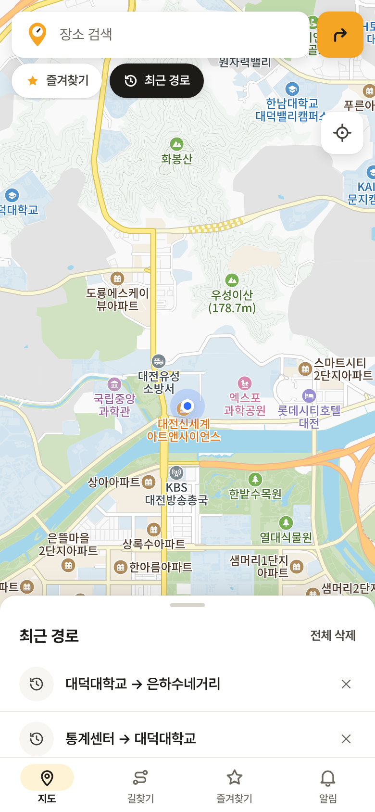
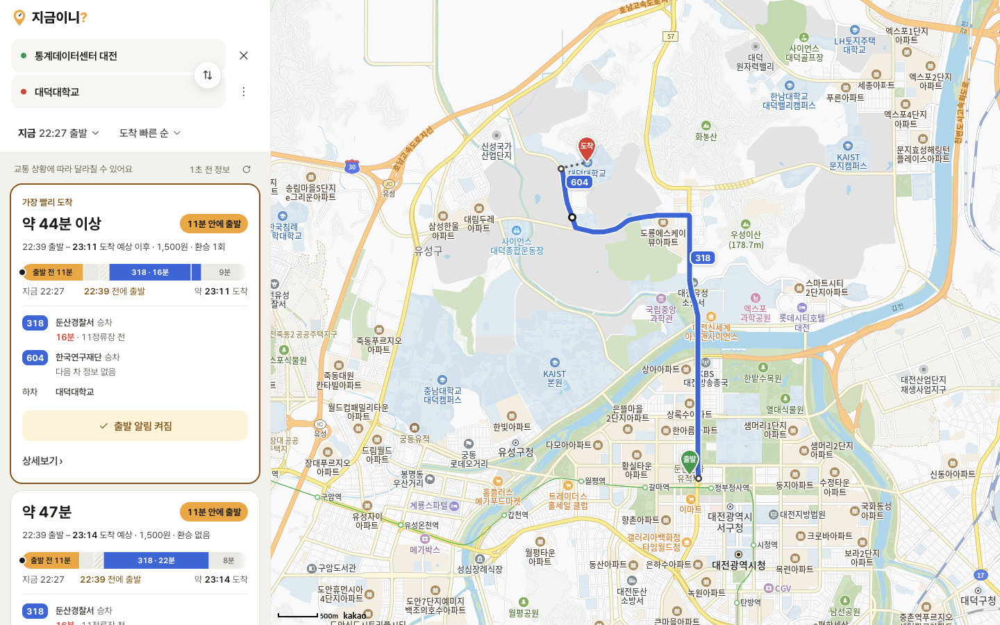
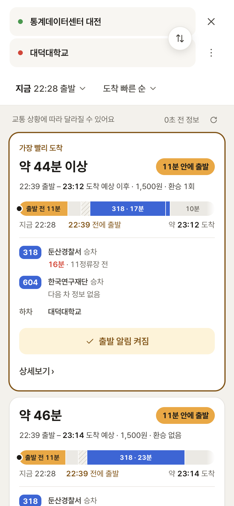
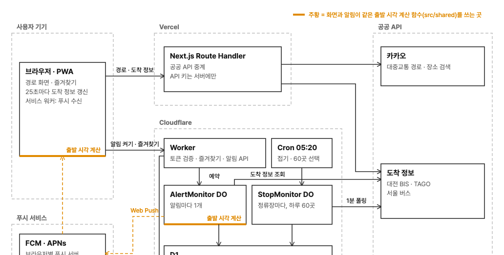

  

<h1 align="center">지금이니?</h1>

  기다림까지 더한 도착 예상 시간과, <b>언제까지 나서면 되는지</b> 알려주는 대전·서울 버스 길찾기

  <a href="https://jigeumini.vercel.app">https://jigeumini.vercel.app</a>

 

## 목차

- [서비스 기능](#서비스-기능)
  - [1. 지도 홈, 즐겨찾기, 최근 경로](#1-지도-홈-즐겨찾기-최근-경로)
  - [2. 장소 검색과 최근 검색](#2-장소-검색과-최근-검색)
  - [3. 장소 카드에서 바로 길찾기](#3-장소-카드에서-바로-길찾기)
  - [4. 경로 목록: 언제 나가면 되는지](#4-경로-목록-언제-나가면-되는지)
  - [5. 경로 상세: 출발부터 도착까지 시간 순서로](#5-경로-상세-출발부터-도착까지-시간-순서로)
  - [6. 출발 알림: 나갈 때가 되면 푸시로](#6-출발-알림-나갈-때가-되면-푸시로)
  - [7. 앱처럼 설치하기 (PWA)](#7-앱처럼-설치하기-pwa)
- [만든 방식](#만든-방식)

 

## 서비스 기능

### 1. 지도 홈, 즐겨찾기, 최근 경로

| 데스크톱 | 모바일 |
| :---: | :---: |
|  |  |

- 앱을 열면 **현재 위치를 중심으로** 지도가 보여요. 대전과 서울에서 쓸 수 있고, 두 도시 밖이면 대전이나 서울 지도로 옮길 수 있어요. 지도 오른쪽 아래 버튼(모바일은 아래 시트 바로 위)으로 언제든 현재 위치로 돌아올 수 있어요.
- 즐겨찾기한 장소는 지도 위에 **주황색 별 마커**로 항상 표시돼요. 마커를 누르면 그 장소 카드가 열려요.
- 로그인 화면 없이 처음 방문할 때 익명 계정이 만들어지고, 즐겨찾기는 그 계정에 저장돼서 새로고침하거나 앱을 다시 열어도 남아 있어요. 즐겨찾기는 50곳까지 저장할 수 있어요.

| 최근 경로 (데스크톱) | 최근 경로 (모바일) |
| :---: | :---: |
|  |  |

- 길찾기한 출발지·도착지 쌍은 **최근 경로**에 최근 8개까지 쌓여요. 누르면 그 경로 목록으로 바로 가고, X로 하나씩 지울 수 있어요. 이 기기에 저장돼요.

 

### 2. 장소 검색과 최근 검색

| 데스크톱 | 모바일 |
| :---: | :---: |
|  |  |

- 검색창에 장소 이름을 입력하면 **현재 위치 주변**의 장소가 거리와 함께 바로 나와요.
- 검색해서 고른 장소는 **최근 검색**에 쌓여요. 이 기기에 저장돼서 다음에 열어도 그대로 있어요.
- 최근 검색은 항목마다 오른쪽 **X**로 하나씩 지우거나, **전체 삭제**로 한 번에 비울 수 있어요.

 

### 3. 장소 카드에서 바로 길찾기

| 데스크톱 | 모바일 |
| :---: | :---: |
|  |  |

- 장소를 고르면 지도가 그 장소로 이동하고, 주소와 현재 위치에서의 거리가 담긴 카드가 열려요.
- 카드의 **출발 / 도착** 버튼을 누르면 그 장소를 출발지나 목적지로 넣고 바로 길찾기로 넘어가요.
- 별 버튼으로 즐겨찾기에 추가하거나 뺄 수 있어요.

 

### 4. 경로 목록: 언제 나가면 되는지

| 데스크톱 | 모바일 |
| :---: | :---: |
|  |  |

- 대중교통 경로에 **대전·서울 버스 실시간 도착 정보**를 합쳐서, 지금 탈 수 있는 버스 기준으로 도착 시각을 계산해요.
- 경로마다 **"8분 안에 출발", "17:22 전에 출발"** 처럼 집에서 언제 나가면 되는지 먼저 보여줘요.
- 막대 그래프 한 줄로 **출발 전 남은 시간 · 걷기 · 정류장 대기 · 버스 탑승**을 시간 비율대로 보여줘요.
- 출발 시각에는 **버스가 예측보다 일찍 오는 경우를 대비한 여유 시간**이 들어 있어요. 정류장별로 실제로 쌓은 도착 예측 오차 데이터(10번 중 9번은 놓치지 않는 기준)로 계산하고, 데이터가 부족한 정류장은 2분을 둬요.
- 여유 시간은 **최소 1분, 최대 5분** 사이로 잡아요. 오차가 큰 정류장이라도 너무 일찍 나가라고 하지 않도록요.
- 탈 정류장에 버스가 **몇 분 뒤, 몇 정류장 전**에 있는지도 함께 보여줘요. 버스는 지역별 공식 노선 색으로 표시돼요.
- 환승이 있는 경로는 **"바로 환승 N%"**를 보여줘요. 환승 정류장에 쌓인 "버스가 얼마나 일찍 왔나" 데이터로 환승 버스를 바로 탈 확률을 계산하고, **확률이 80% 이상인 첫 버스**를 탈 버스로 잡아요.
- 환승 정류장에 데이터가 없으면 확률은 보여주지 않고, 내린 뒤 **1분 이상 여유가 있는 첫 버스**로 잡아요.
- 경로 카드를 누르면 바로 그 경로의 상세 화면으로 넘어가요.
- 도착 정보가 몇 초 전 것인지 **"N초 전 정보"가 1초마다** 올라가고, 새로고침 버튼으로 바로 다시 받을 수 있어요. 불러오지 못하면 **다시 시도** 버튼이 뜨고, 다시 시도도 실패하면 토스트로 알려줘요.
- 도착 빠른 순 / 도보 짧은 순 / 환승 적은 순으로 정렬할 수 있어요.

 

### 5. 경로 상세: 출발부터 도착까지 시간 순서로

| 데스크톱 | 모바일 |
| :---: | :---: |
|  |  |

- 출발 전 대기 → 걷기 → 승차 정류장 → 하차 → 도착까지 **시각과 함께 한 줄 타임라인**으로 보여줘요.
- 환승 구간마다 바로 환승 확률을 따로 보여주고, 환승이 두 번 이상이면 모두 바로 탈 확률도 함께 보여줘요.
- 지도에는 걷는 구간과 버스 구간이 노선 색으로 그려져요.
- 위쪽 탭으로 다른 경로로 바로 바꿔 볼 수 있어요.

 

### 6. 출발 알림: 나갈 때가 되면 푸시로

| 데스크톱 | 모바일 |
| :---: | :---: |
|  |  |

- 경로의 **출발 알림 받기**를 누르면 알림 권한을 묻고, 허용하면 "출발 알림 켜짐"으로 바뀌어요.
- 알림을 켜 두면 서버가 **실시간 도착 정보로 나가야 하는 시각을 계속 다시 계산**해요. 버스가 늦어지면 알림도 그만큼 늦게 와요.
- 나가야 하는 시각 **2분 전에 푸시 알림을 한 번** 보내요. 알림을 누르면 그 경로의 상세 화면이 열려요.
- 다시 누르면 알림이 꺼지고, 예약된 푸시도 취소돼요.
- 알림을 켜 둔 뒤 탈 버스가 사라지거나, 도착 정보 API에 장애가 나거나, 알림을 켠 지 3시간이 지나면 **"출발 알림을 보내지 못했어요" 푸시**로 이유와 함께 알려줘요. 이 푸시는 30분 동안 유효해서, 그 사이 폰이 다시 연결되면 받을 수 있어요.
- 알림 등록 자체가 실패하면(알림 권한·구독이 없거나 등록 개수를 넘으면) 화면에 토스트로 이유를 알려줘요.
- 데스크톱에서는 버튼 아래에 **"알림은 이 컴퓨터로 와요"** 안내가 붙어요. 폰으로 받으려면 폰에서 켜야 해요.
- 아이폰에서는 **홈 화면에 추가한 앱**에서만 알림을 받을 수 있어요. (iOS 16.4 이상)

 

### 7. 앱처럼 설치하기 (PWA)

| 아이폰 시작 화면 |
| :---: |
|  |

- 브라우저에서 **홈 화면에 추가**하면 주소창 없이 앱처럼 열려요. (아이폰: Safari 공유 → 홈 화면에 추가, 안드로이드: Chrome 메뉴 → 앱 설치)
- 실행할 때는 흰 화면에 서비스 아이콘과 이름이 뜨는 시작 화면이 보여요.

 

## 만든 방식

- **화면 (Next.js App Router · TypeScript)**: 카카오맵 위에 경로를 그리고, TanStack Query로 실시간 도착 정보를 25초마다 다시 받아요. PWA로 설치할 수 있고, 서비스 워커가 푸시를 받아요.
- **공공 API 중계 (Next.js Route Handler on Vercel)**: 카카오 길찾기·장소 검색, 대전 BIS·TAGO, 서울 버스 API를 서버에서 호출해 API 키가 브라우저로 나가지 않아요. 지역마다 같은 모양의 함수(정류장 찾기 · 도착 정보 받기)로 나눠, 서울을 더할 때 화면 코드는 바꾸지 않았어요.
- **Cloudflare Worker + D1**: Firebase 익명 로그인의 ID 토큰을 jose로 검증하고, 즐겨찾기·알림·푸시 구독을 D1에 저장해요.
- **AlertMonitor (Durable Object)**: 알림마다 하나씩 떠서 도착 정보를 다시 받고, 화면과 **같은 출발 시각 계산 함수**(`src/shared`)로 나가야 할 시각을 다시 계산해 2분 전에 Web Push(VAPID)를 보내요.
- **StopMonitor (Durable Object) + Cron**: 정류장마다 1분 간격으로 "예측 도착 vs 실제 도착" 오차를 모아 정류장별 히스토그램으로 D1에 쌓아요. 도착 3·5·10분 전 예측은 출발 여유 계산에, 15·20분 전 예측은 환승처럼 먼 버스를 보기 위해 모으고 있어요. 매일 05:20 Cron이 대전 정류장 중 그날 지켜볼 60곳을 골라 돌아가며 수집해요.
- **여유 시간**: 정류장별 오차에서 버스가 일찍 오는 쪽 P10(10번 중 9번은 놓치지 않는 기준)을 쓰고, 데이터가 100건 미만인 정류장은 2분을 둬요.
